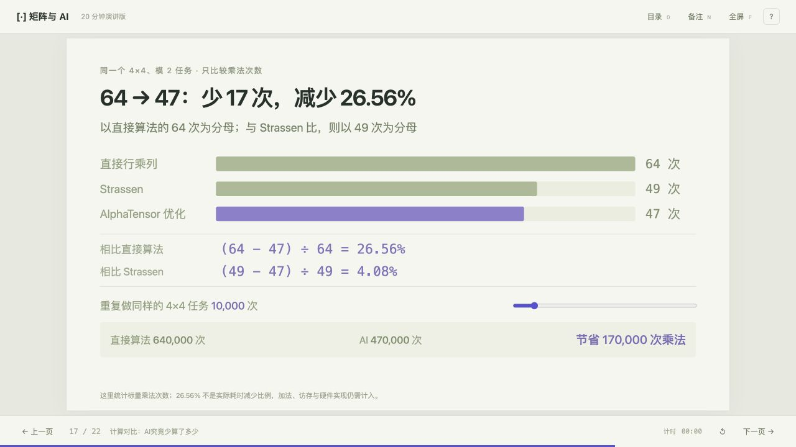

# AI 如何发现更快的矩阵乘法

中文交互式 HTML 演讲项目，约 20 分钟、22 页。用晶体管与寄存器动画建立硬件直觉，再以同一组 4×4 矩阵讲解 AlphaTensor、AlphaEvolve 和算法计算对比。



## 直接打开演讲

下载项目后，用浏览器打开根目录的 **[矩阵与AI-20分钟演讲.html](矩阵与AI-20分钟演讲.html)**。

这是可离线使用的单文件，已内嵌样式、脚本、算法数据和许可说明。GitHub 文件页面显示源码，下载文件后才能在浏览器中播放。

也可以打开 [dist/slides.html](dist/slides.html)。[dist/index.html](dist/index.html) 是最初的滚动式交互教程，演讲版以 `slides.html` 为准。

- `←` / `→`：翻页
- `F`：全屏
- `N`：显示本页演讲备注与来源
- `O`：目录
- `T`：演讲计时
- 各页的播放、单步和重置按钮：控制动画

## 内容与计算口径

- 晶体管、静态存储、寄存器、整数加乘、GPU 并行和数据复用。
- 普通矩阵乘法与 Strassen 只保留两个主讲基线页面，完整 Strassen 公式保存在备注中。
- AI 部分包含真实分解步骤、搜索思路、同一输入的数值核对、完整关系验证和运算成本对比。
- 在统一 **4×4、模 2** 条件下，乘法次数为 **64 / 49 / 47**。AlphaTensor 相比直接法减少 17 次（26.56%），相比 Strassen 减少 2 次（4.08%）。
- 统一直接展开、未共享额外加法中间项时，三种方案的 XOR 次数为 **48 / 318 / 340**。该计数与经典递归 Strassen 的 198 次加减法属于不同实现口径。
- AlphaEvolve 的 **4×4 复数矩阵、48 次标量乘法**属于另一个数域设定，不与模 2 的 47 次直接混比。
- 乘法次数和教学成本模型都不是实际硬件运行时间；页面未训练 AI，而是执行作者公开的分解。

## 构建与本地预览

构建和校验使用 Node.js 内置模块，无需安装 npm 依赖。

```bash
node scripts/build-presentation.mjs
```

构建同时更新 `dist/slides.html` 和根目录的离线演讲文件。

如需本地 HTTP 预览，可使用 Python 3：

```bash
python3 -m http.server 8931 --directory dist
```

随后访问 <http://127.0.0.1:8931/slides.html>，滚动教程位于 <http://127.0.0.1:8931/>。

## 校验

```bash
node scripts/verify-ai-focus.mjs
node scripts/verify-comparison.mjs
node scripts/verify-hardware-lesson.mjs
node scripts/verify-register-physics.mjs
node scripts/verify-strassen-derivation.mjs
```

校验覆盖公开分解的全部 4096 个系数、随机矩阵样本、乘法与 XOR 计数、百分比和成本模型、二进制算术及存储状态，并检查页数、备注和建议用时的一致性。

## 目录

```text
presentation/     演讲模板、样式、交互动画与教学模型
dist/             可直接使用的静态网页、算法数据与离线演讲
scripts/          构建与数学、数据、页面结构校验
docs/             项目预览
矩阵与AI-20分钟演讲.html  可下载的完整离线演讲
```

## 论文、数据与许可

- [AlphaTensor 论文](https://doi.org/10.1038/s41586-022-05172-4)
- [AlphaTensor 作者开源仓库](https://github.com/google-deepmind/alphatensor)
- [AlphaEvolve 白皮书](https://arxiv.org/abs/2506.13131)
- [NVIDIA 矩阵乘法指南](https://docs.nvidia.com/deeplearning/performance/dl-performance-matrix-multiplication/)

`dist/alpha47.js` 使用 AlphaTensor 作者公开的 rank-47 分解，来源版本与校验摘要记录在文件内。相关数据保留 Apache 2.0 许可说明，见 [dist/alphatensor-LICENSE.txt](dist/alphatensor-LICENSE.txt)。该说明也嵌入离线 HTML。其他引用链接保存在演讲备注中。

本地凭据、日志、部署账号配置及依赖目录不属于项目分发内容，已加入 Git 忽略规则。
